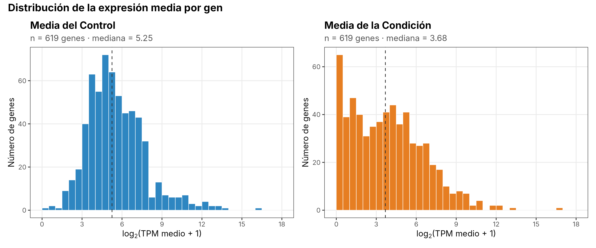
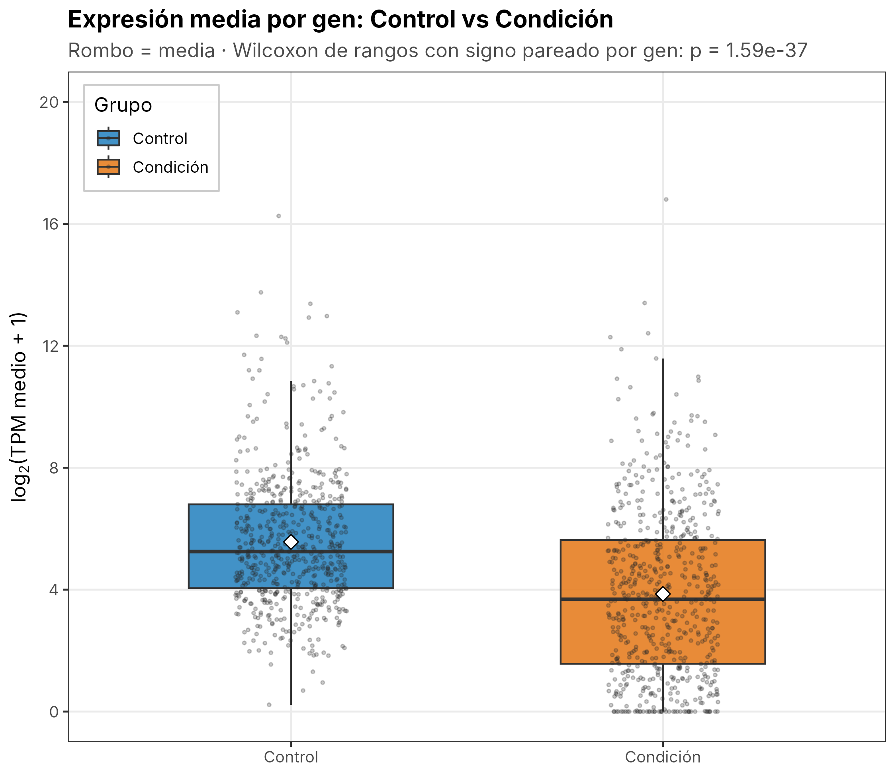
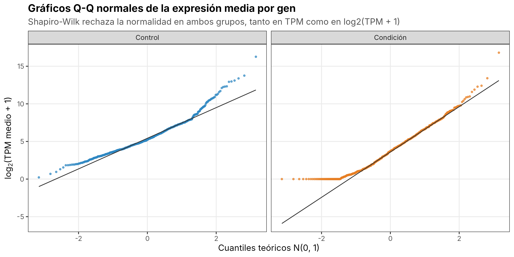
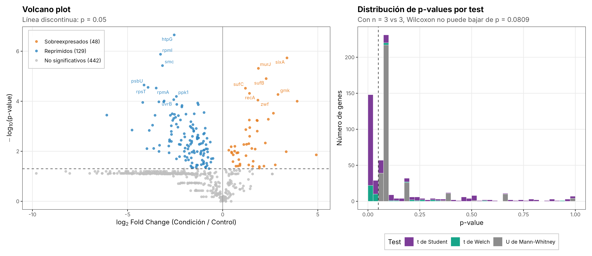
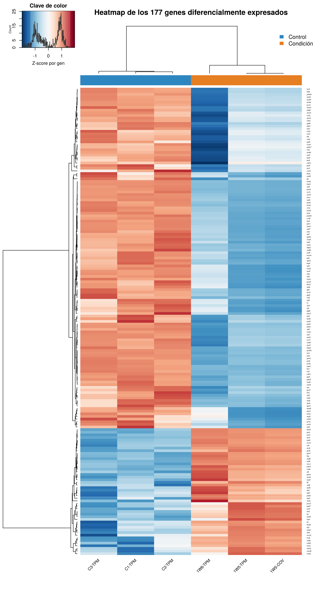
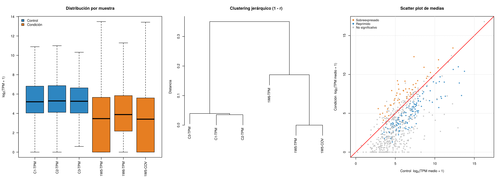

# Trabajo Final R · Análisis de expresión diferencial (versión 2)

[](https://colab.research.google.com/github/ismabilon/Bioinformatica_Biomedicina_4to-Curso_2026-2027/blob/main/R/Entregas/Trabajo%20Final%20R/01.01%20-%20Trabajo-R-Final_Realizado-v2.ipynb)

Análisis de un experimento de RNA-seq cuantificado en TPM: 619 genes, 3 réplicas de **Control** (`C1-TPM`, `C2-TPM`, `C3-TPM`) y 3 de **Condición** (`1W5-TPM`, `1W6-TPM`, `1W5-COV`), según los siete apartados de la tarea `TrabajoR.R`.

## Resultado principal

| Indicador | Valor |
|---|---|
| Genes analizados | 619 |
| Genes diferencialmente expresados (p < 0.05) | **177** (28,6 %) |
| Sobreexpresados en la Condición | **48** |
| Reprimidos en la Condición | **129** |
| Significativos tras corrección de Benjamini-Hochberg (FDR < 0.05) | 111 |

La Condición reduce la expresión de forma generalizada: la mediana de log2(TPM medio + 1) baja de 5,25 a 3,68 (Wilcoxon pareado por gen, p = 1,6·10⁻³⁷), y 2 de cada 3 genes significativos están reprimidos.

## Contenido de la carpeta

| Archivo | Descripción |
|---|---|
| `01.01 - Trabajo-R-Final_Realizado-v2.r` | Script definitivo, modular y reproducible |
| `01.01 - Trabajo-R-Final_Realizado-v2.ipynb` | Cuaderno de Colab (kernel R) ya ejecutado, con todas las salidas |
| `archivo-entrada.txt` | Datos de entrada |
| `resultados/figuras/` | 6 figuras en PNG (300 ppp) y PDF vectorial |
| `resultados/tablas/` | Tabla completa, genes DE, normalidad, tests, sensibilidad y `sessionInfo` |

## Reproducción

```bash
cd "R/Entregas/Trabajo Final R"
Rscript "01.01 - Trabajo-R-Final_Realizado-v2.r"
```

El script instala las dependencias que falten (`data.table`, `ggplot2`, `patchwork`, `gplots`, `RColorBrewer`, `ggrepel`, `knitr`), fija la semilla (`set.seed(20262027)`), usa rutas relativas y, si `archivo-entrada.txt` no está en el directorio de trabajo, lo descarga de este repositorio. Por eso el cuaderno se puede volver a ejecutar en Colab sin subir ningún archivo.

## Recursos del ZIP integrados

| Recurso | Uso en la versión 2 |
|---|---|
| `PracticasLab-Talleres/P5_R.R` (la «Práctica de R» que cita el apartado 7) | Heatmap con `gplots::heatmap.2`, dendrogramas por distancia de correlación `1 - r`, `scale = "row"`, exportación a PDF y `write.table` de los genes DE. También el boxplot por muestra, el clustering jerárquico de muestras, el scatter plot con diagonal y el volcano plot |
| `PracticasLab-Talleres/P5_GSE5583_DE_Heatmap--deJose-.pdf` | Referencia visual del heatmap; se elimina la traza cian (`trace = "none"`) para que se lea mejor |
| `Temario/2_RStatistics.R` | Shapiro-Wilk, prueba F de varianzas (`var.test`), t de Student y de Welch, Wilcoxon y corrección de p-values con `p.adjust` (Benjamini-Hochberg) |
| `Temario/1_IntroduccionR.R` | `apply()` como validación cruzada de las medias y DE vectorizadas; leyendas con `legend()` |
| `Trabajo final R/JoseA.PallaresH._Trabajo2.R` | `ggplot2` + `patchwork` para figuras compuestas, `var.test` antes de elegir la t, y `aggregate`/`tapply` como estilo de resumen |
| `Trabajo final R/datos-trabajoR.txt` y PDFs | Pertenecen a otra tarea (Wildtype/Sequía/ExcesoRiego); no se mezclan con estos datos |

## Mejoras respecto a la versión 1

1. **Heatmap fiel a la Práctica**: `heatmap.2` con dendrogramas de correlación, paleta divergente `RdBu` de RColorBrewer, clave de color con histograma y barra de grupo.
2. **Elección del test con una regla completa por gen**: Shapiro-Wilk en cada grupo → si ambos son normales, prueba F → t de Student (varianzas iguales) o de Welch; si no, U de Mann-Whitney. La v1 no comprobaba la igualdad de varianzas.
3. **Normalidad evaluada también a nivel global**, como pide literalmente el enunciado (Shapiro-Wilk sobre las medias, en TPM y en log2, y gráficos Q-Q).
4. **Corrección por comparaciones múltiples** (Benjamini-Hochberg) como columna adicional.
5. **Control de calidad de las muestras y análisis de sensibilidad**, que revelan que una réplica de la Condición no es independiente (ver más abajo).
6. **Ingeniería**: gestión de dependencias, validación de tipos y estructura de los datos, `tryCatch` en lectura, instalación y en cada test, cálculo vectorizado (`rowMeans`, DE por filas, Welch vectorizado), `data.table` para la entrada/salida y la manipulación, exportación de todas las figuras y tablas y limpieza de memoria.

## Métodos y resultados por apartado

### 1. Carga y exploración
Lectura con `data.table::fread` (soporta los saltos de línea CRLF del archivo), validación de columnas, tipos numéricos, ausencia de NA y de valores negativos, y unicidad de los nombres de gen. Las columnas se reordenan a C1, C2, C3 (el archivo trae C2, C1, C3). Hay 518 valores TPM iguales a 0, casi todos en la Condición.

### 2. Media y desviación estándar
Se calculan de forma vectorizada y se comprueba con `stopifnot` que coinciden exactamente con `apply(…, 1, mean)` y `apply(…, 1, sd)`. Se añaden `Media_Control`, `DE_Control`, `Media_Condicion` y `DE_Condicion`.

### 3. Histogramas
Colores fijos para todo el trabajo: **Control `#2E86C1` (azul)** y **Condición `#E67E22` (naranja)**, los mismos dos tonos que la Práctica usa para sus dos grupos. Se representa log2(TPM medio + 1) porque los TPM brutos van de 0 a ~114 000 y el histograma en escala lineal queda reducido a una sola barra.



### 4. Boxplot
Boxplot con los puntos de cada gen superpuestos, la media marcada con un rombo y la leyenda en la esquina superior izquierda.



### 5. Normalidad y test por gen
**Nivel global.** Shapiro-Wilk rechaza la normalidad de las medias de ambos grupos en las dos escalas:

| Grupo | Escala | W | p |
|---|---|---|---|
| Control | TPM | 0,068 | 2,1·10⁻⁴⁷ |
| Control | log2(TPM + 1) | 0,951 | 1,9·10⁻¹³ |
| Condición | TPM | 0,033 | 5,5·10⁻⁴⁸ |
| Condición | log2(TPM + 1) | 0,957 | 2,1·10⁻¹² |



**Nivel de gen.** La comparación de medias se hace gen a gen con 3 frente a 3 valores, así que la normalidad relevante es la de cada gen y su elección del test es la que se aplica:

| Test | Genes | p mínimo | p < 0,05 |
|---|---|---|---|
| t de Student | 262 | 2,2·10⁻⁷ | 145 |
| t de Welch | 48 | 4·10⁻⁴ | 32 |
| U de Mann-Whitney | 309 | 0,0636 | 0 |

Los 309 genes que pasan a Wilcoxon (230 de ellos tienen algún cero en la Condición) **nunca pueden ser significativos**: con n = 3 frente a 3, el p-value más pequeño posible es 0,10 en la prueba exacta y 0,081 en la aproximación normal (0,064 con empates). Es una limitación de potencia del diseño, no una ausencia de efecto: muchos de esos genes pasan de decenas de TPM a 0.

### 6. Genes diferencialmente expresados
177 genes con p < 0,05: **48 sobreexpresados** y **129 reprimidos**. El listado completo está en `resultados/tablas/Genes_diferencialmente_expresados.tsv`. Los diez más significativos:

| Gen | Media Control | Media Condición | log2FC | p | FDR (BH) | Regulación |
|---|---|---|---|---|---|---|
| htpG | 75,1 | 12,0 | −2,55 | 2,2·10⁻⁷ | 1,4·10⁻⁴ | Reprimido |
| rpmI | 823,8 | 84,7 | −3,27 | 1,3·10⁻⁶ | 3,8·10⁻⁴ | Reprimido |
| sixA | 22,3 | 241,8 | 3,38 | 1,8·10⁻⁶ | 3,8·10⁻⁴ | Sobreexpresado |
| smc | 41,3 | 3,7 | −3,16 | 3,8·10⁻⁶ | 5,8·10⁻⁴ | Reprimido |
| murJ | 47,3 | 176,7 | 1,88 | 4,8·10⁻⁶ | 6,0·10⁻⁴ | Sobreexpresado |
| sufB | 396,1 | 1936,5 | 2,29 | 1,2·10⁻⁵ | 1,3·10⁻³ | Sobreexpresado |
| psbU | 2571,9 | 145,6 | −4,13 | 2,2·10⁻⁵ | 1,9·10⁻³ | Reprimido |
| rpsT | 1835,5 | 120,2 | −3,92 | 2,8·10⁻⁵ | 1,9·10⁻³ | Reprimido |
| rpmA | 1238,1 | 109,0 | −3,49 | 3,0·10⁻⁵ | 1,9·10⁻³ | Reprimido |
| sufC | 89,6 | 206,6 | 1,20 | 3,0·10⁻⁵ | 1,9·10⁻³ | Sobreexpresado |

Desde el punto de vista biológico, el patrón es coherente con una respuesta a estrés en un organismo fotosintético: se reprimen genes del fotosistema (psbU, psaI) y proteínas ribosómicas (rpmI, rpmA, rpsT), y se inducen el sistema SUF de ensamblaje de centros Fe-S (sufB, sufC) y genes de envoltura celular (murJ, murC).



### 7. Heatmap
log2(TPM + 1) de los 177 genes DE, escalado por fila (Z-score), con dendrogramas de correlación (`1 - r`, enlace promedio) para genes y muestras, como en la Práctica. Las muestras se separan perfectamente por grupo.



## Control de calidad y hallazgo crítico: `1W5-COV` no es una réplica independiente



`1W5-COV` es exactamente `0,957963 × 1W5-TPM` en los 619 genes (DE del cociente = 1,4·10⁻⁷; r de Pearson = 1,000000). Es la misma librería expresada en otra unidad (cobertura), no una tercera réplica biológica. La Condición tiene, en realidad, **dos réplicas independientes**. Tratarla como tres, como indica el enunciado, subestima la varianza y hace los p-values algo optimistas. El análisis de sensibilidad cuantifica el efecto:

| Escenario | p < 0,05 | FDR < 0,05 | Coinciden con el principal |
|---|---|---|---|
| Principal: test según normalidad (3 vs 3, TPM) | 177 | 111 | 177 |
| Welch sobre log2(TPM + 1) (3 vs 3) | 322 | 211 | 152 |
| Welch sobre log2(TPM + 1) sin `1W5-COV` (3 vs 2) | 156 | 45 | 90 |

El análisis principal sigue el diseño del enunciado; el escenario 3 frente a 2 es el más honesto con los datos y conserva un núcleo robusto de genes, aunque con menos significación tras la corrección múltiple.

## Limitaciones
- Con n = 3 por grupo, Shapiro-Wilk tiene muy poca potencia, y la elección entre t y Wilcoxon por gen es la que pide la asignatura, no la práctica habitual en RNA-seq (modelos binomiales negativos como DESeq2 o edgeR sobre conteos brutos, que aquí no están disponibles).
- El criterio del enunciado (p < 0,05 sin corregir) admite falsos positivos al hacer 619 pruebas; por eso se informa también el FDR.
- La pseudo-réplica `1W5-COV` reduce el tamaño muestral efectivo de la Condición.

## Entorno
R 4.3.3 · data.table 1.14.10 · ggplot2 3.4.4 · patchwork 1.2.0 · gplots 3.1.3.1 · RColorBrewer 1.1.3 · ggrepel 0.9.5 · knitr 1.45. El detalle completo está en `resultados/tablas/sessionInfo.txt`.
